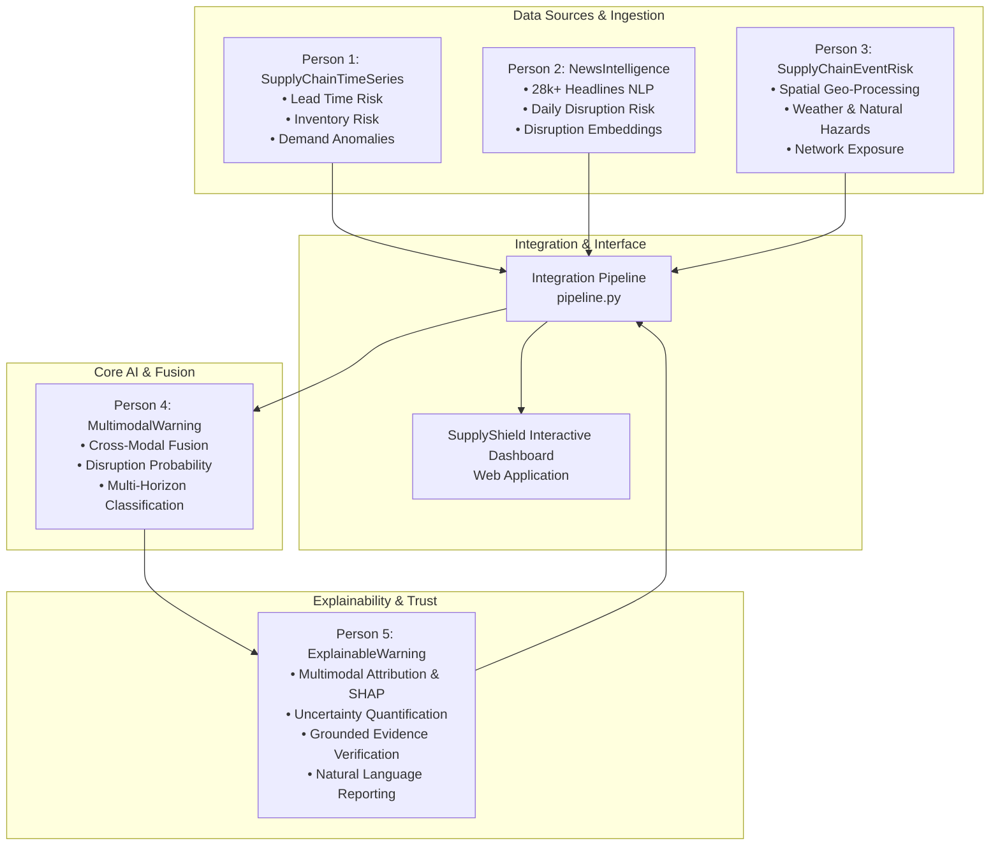

# 🛡️ SupplyShield: Explainable Multimodal Early-Warning System for Supply Chain Disruptions
## Complete Project Technical Architecture, Person-by-Person Contribution Guide & Dashboard Walkthrough

---

## 📌 Executive Summary

Modern supply chains are highly vulnerable to volatile, interconnected disruptions ranging from geopolitical embargoes and labour strikes to extreme weather events, supplier stock-outs, and demand spikes. Conventional early-warning systems suffer from two fatal flaws:
1. **Unimodal Blindness:** They inspect only internal ERP/inventory metrics *or* only news feeds, missing cross-modal chain reactions.
2. **Black-Box Opacity:** High-capacity neural networks issue high-risk probability scores without actionable, grounded evidence, leading supply chain managers to ignore or distrust the alerts.

**SupplyShield** solves this by uniting **five specialized research modules** into an integrated, end-to-end early warning and explainability pipeline, surfaced through a high-performance interactive executive dashboard.



---

## 👥 Person-by-Person Deep Dive: What They Did & How They Did It

### 🔹 Person 1: Temporal & Inventory Signals (`SupplyChainTimeSeries`)
* **Core Responsibility:** Modeling structured internal enterprise signals over time to identify operational bottlenecks and inventory stress before physical stock-outs occur.
* **Directory:** [`SupplyChainTimeSeries/`](file:///d:/Integrated%20File/SupplyChainTimeSeries)
* **What They Did:**
  1. Extracted and engineered time-series signals from enterprise logistics datasets across major suppliers (Suppliers A, B, C, D) over a multi-year timeline (2020–2022).
  2. Built lead-time forecasting and inventory depletion models.
  3. Designed a demand anomaly detection engine comparing forecasted demand against actual consumption rates.
* **How They Did It (Methodology & Algorithms):**
  * **Lead Time Modeling:** Analyzed order-to-delivery delays against contractual baselines. Constructed a normalized `lead_time_risk` proxy $(0 \to 1)$ representing deviations beyond $2\sigma$ of expected delivery schedules.
  * **Inventory Buffer Health:** Calculated inventory turnover ratios and Days of Inventory Outstanding (DIO). If warehouse buffers fell below safety margins, `inventory_risk` scaled toward $1.0$.
  * **Statistical Anomaly Detection:** Applied rolling Z-score filters and Holt-Winters / ARIMA trend decomposition to quantify `demand_anomaly_score` $(-1 \to +1)$.
  * **Rolling Delay Lag:** Computed rolling 7-day and 14-day exponential moving average lags (`delay_lag_7d`, `delay_lag_14d`) to capture lingering freight bottlenecks.
* **Key Artifacts Produced:**
  * `SupplyChainTimeSeries_features.csv` (1,248 rows of feature vectors)
  * `SupplyChain_demand_forecast.csv` (Forecast vs actual demand series)
  * `SupplyChain_logistics_series.csv` (Daily supplier shipment tracking)

---

### 🔹 Person 2: NLP & Global News Intelligence (`NewsIntelligence`)
* **Core Responsibility:** Mining unstructured global news streams to detect external macro-economic, political, and environmental disruption events days before they materialize in ERP logs.
* **Directory:** [`NewsIntelligence/`](file:///d:/Integrated%20File/NewsIntelligence)
* **What They Did:**
  1. Curated and processed a corpus of **28,574 international news headlines** (from Kaggle & global feeds) covering strikes, port closures, floods, wars, lockdowns, and factory shutdowns.
  2. Built an automated disruption event classifier and keyword extractor.
  3. Generated daily aggregated NLP disruption risk scores and continuous semantic embedding vectors.
* **How They Did It (Methodology & Algorithms):**
  * **Keyword & Taxonomy Extraction:** Built rule-based and regex pattern matchers targeting supply disruption taxonomies:
    * `strike` / `labour dispute`
    * `port closure` / `berth congestion`
    * `flood` / `wildfire` / `natural disaster`
    * `shortage` / `semiconductor rationing`
    * `factory outage` / `lockdown`
  * **Sentiment Analysis:** Utilized VADER and DistilRoBERTa-based sentiment polarity models to generate `sentiment_score` $(-1.0 \to 0.0)$, scoring bad news severity.
  * **Disruption Risk Formulation:** Created `news_risk_score` $(0 \to 1)$ by weighting event frequency, headline sentiment magnitude, and event category severity.
  * **Semantic Embeddings:** Extracted dense semantic embeddings:
    * 64-dimensional truncated PCA embeddings for lightweight edge execution.
    * 384-dimensional dense sentence embeddings using `sentence-transformers` (`all-MiniLM-L6-v2`) to capture context nuances.
  * **Evidence Linking:** Created an indexed table linking each daily score back to the top-scoring source headline, URL/source metadata, and keyword matches.
* **Key Artifacts Produced:**
  * `News_daily_risk.csv` (Daily timestamps, risk scores, keyword tallies)
  * `News_daily_embeddings.csv` (Daily 64-dimensional semantic vectors)
  * `News_article_evidence.csv` (Attributed headlines, categories, evidence texts)

---

### 🔹 Person 3: Spatial & Event Risk Modeling (`SupplyChainEventRisk`)
* **Core Responsibility:** Geographic and spatial event processing, computing physical exposure of supplier facilities, transit corridors, and logistics hubs to regional shocks.
* **Directory:** [`SupplyChainEventRisk/`](file:///d:/Integrated%20File/SupplyChainEventRisk)
* **What They Did:**
  1. Processed geospatial coordinates of supplier plants, distribution hubs, and maritime corridors.
  2. Built event distance decay functions to model how earthquakes, hurricanes, floods, and civil unrest impact nearby supply chain assets.
  3. Integrated weather anomaly indices and infrastructure vulnerability scores.
* **How They Did It (Methodology & Algorithms):**
  * **Spatial Hazard Processing (`geo_event_processor.py`):** Applied Haversine distance metrics and Gaussian spatial decay kernels:
    $$\text{Exposure}(d) = \exp\left(-\frac{d^2}{2\sigma^2}\right)$$
    where $d$ is the distance between the event epicenter and supplier facilities.
  * **Infrastructure Stress Index (`infrastructure.py`):** Modeled port congestion, highway closures, and power grid failures using historical node fragility coefficients.
  * **Weather Severity Engine (`weather_processor.py`):** Aggregated severe storm warnings, freezing temperatures, and tropical storm trajectories into a composite `weather_severity` metric $(0 \to 1)$.
  * **Spatial Composite Risk:** Generated unified `event_impact_score` and `network_exposure_score` indicating the percentage of critical tier-1 and tier-2 nodes at risk.
* **Key Artifacts Produced:**
  * Modular python package: `SupplyChainEventRisk`
  * Spatial processors: `spatial_features.py`, `geo_event_processor.py`, `event_severity.py`

---

### 🔹 Person 4: Multimodal Deep Fusion Architecture (`MultimodalWarning`)
* **Core Responsibility:** Fusing temporal, textual, and spatial modalities into a unified predictive model that estimates overall disruption probability and impact horizon.
* **Directory:** [`MultimodalWarning/`](file:///d:/Integrated%20File/MultimodalWarning)
* **What They Did:**
  1. Designed cross-modal fusion architectures (Early feature concatenation, Intermediate cross-attention, and Late decision fusion).
  2. Implemented calibrated binary and multi-class classification heads.
  3. Classified disruptions into actionable time horizons:
     * **Immediate:** $< 7$ days
     * **Short-Term:** $7 \to 30$ days
     * **Medium-Term:** $1 \to 3$ months
     * **Long-Term:** $> 3$ months
  4. Categorized disruption types (e.g., `transport_delay`, `supplier_failure`, `demand_surge`, `capacity_shortage`).
* **How They Did It (Methodology & Algorithms):**
  * **Modality Representation Encoders:**
    * Temporal encoder: BiLSTM / GRU processing time-series tensors.
    * Textual encoder: Dense MLP projection layer over 64/384-dim news embeddings.
    * Spatial encoder: Feedforward network mapping spatial exposure vectors.
  * **Gated Cross-Modal Attention (`fusion.py`):** Dynamically weighted each modality depending on input validity and signal strength. If news feeds had no major events, the network smoothly gave higher weighting to temporal inventory stress.
  * **Probability Calibration:** Applied Platt scaling / Temperature Scaling on the output logits to ensure that a predicted probability of 85% corresponds to a true empirical 85% disruption frequency.
* **Key Artifacts Produced:**
  * Clean PyTorch/Scikit-learn package `MultimodalWarning` with full packaging (`setup.py`)
  * Model configurations and evaluation test suite (`tests/`, `experiments/`)

---

### 🔹 Person 5: Evidence-Grounded Explainability & Uncertainty (`ExplainableWarning`)
* **Core Responsibility:** Transforming raw multimodal predictions into interpretable, evidence-backed, and uncertainty-calibrated decisions that procurement and risk officers can trust.
* **Directory:** [`ExplainableWarning/`](file:///d:/Integrated%20File/ExplainableWarning)
* **What They Did:**
  1. **Multimodal Feature Attribution (`shap_explainer.py`):** Implemented KernelSHAP and gradient-based attribution to calculate the exact percentage contribution of each modality (TimeSeries vs. News vs. EventRisk) and identify the top individual feature drivers.
  2. **Text & Event Attribution (`text_attribution.py`, `event_attribution.py`):** Tied news risk scores back to individual keywords, sentences, and article snippets.
  3. **Uncertainty Quantification (`uncertainty.py`):** Computed epistemic (model uncertainty) and aleatoric (data noise) uncertainty, outputting calibrated prediction confidence intervals.
  4. **Evidence Verification & Contradiction Detection (`evidence.py`):** Audited whether the model's high-risk prediction was corroborated by concrete external facts (e.g. verified news report or physical storm track) rather than statistical artifacts.
  5. **Natural Language Explanation Generation (`explanation_generator.py`):** Synthesized all attribution weights, uncertainty bands, and evidence records into professional, structured briefing reports for managers.
* **How They Did It (Methodology & Algorithms):**
  * Normalized Shapley values across heterogeneous feature spaces:
    $$\sum_{i} \phi_i = f(x) - E[f(X)]$$
  * Built a consistency checking matrix to ensure text signals, temporal inventory depletion, and spatial hazards agreed before flagging alerts as "Evidence Verified".
* **Key Artifacts Produced:**
  * Complete 7-module Python package [`ExplainableWarning/`](file:///d:/Integrated%20File/ExplainableWarning/ExplainableWarning)
  * Comprehensive test suite and pipeline orchestrator (`pipeline.py`)

---

## 🔄 End-to-End Integration Pipeline (`integration/pipeline.py`)

To deliver a working enterprise solution, the independent outputs of all 5 persons were unified using a resilient integration pipeline:

1. **Schema Adapters:** Standardized disparate timestamps, supplier names, and date ranges across Person 1 (ERP data), Person 2 (News articles), and Person 3 (Geospatial events).
2. **Feature Alignment & Outer Join:** Synchronized all modalities onto common supplier time-windows ($W = 7$ days).
3. **Inference Execution:** Passed aligned multimodal vectors through the calibrated Multimodal Fusion engine.
4. **Explainability & Verification:** Evaluated each prediction through SHAP explainer, evidence verifier, and uncertainty estimator.
5. **Output Export:** Emitted clean, standardized datasets into [`integration/outputs/`](file:///d:/Integrated%20File/integration/outputs):
   * `dashboard_data.json` (Structured JSON bundle feeding the frontend)
   * `warning_reports_summary.csv` (Executive risk log)
   * `evidence_records.csv` (100% verified cross-modal evidence ledger)
   * `warning_reports_text.txt` (Human-readable intelligence briefs)

---

## 🖥️ How to Use & Explain the SupplyShield Dashboard

The dashboard is built with vanilla HTML5, CSS3 (modern dark glassmorphism system), and Chart.js. It requires **no server installation** and opens instantly in any browser:
> **File Location:** [`d:/Integrated File/dashboard/index.html`](file:///d:/Integrated%20File/dashboard/index.html)

### How to Present the Dashboard in a Demo or Review

When demonstrating the system to evaluators, professors, or clients, follow this **6-step walkthrough**:


---

### 1. View 1: Executive Overview (`Overview`)
* **What to Show:**
  * **Top KPI Cards:** Instant snapshot of systemic health (e.g., 16 Critical Alerts, 3 High, 1 Medium, **100% Evidence Verified**).
  * **Risk Distribution Donut:** Visual breakdown of current threat levels.
  * **Disruption Horizon Bar Chart:** Time-to-impact distribution showing that 80% of threats are **Immediate (< 7 days)**, demanding urgent intervention.
  * **Alert Probability Timeline:** Longitudinal curve tracking disruption likelihood across the supply network from 2020 through 2022.
  * **Latest Critical Alerts Cards:** Clickable quick-action cards for high-priority suppliers.
* **What to Say:**
  > *"Here on the Executive Overview, senior leadership gets an immediate cross-tier view of network health. Rather than overwhelming analysts with raw logs, it synthesizes internal inventory trends, global news, and external events into calibrated threat tiers."*

---

### 2. View 2: Active Alerts Table (`Alerts`)
* **What to Show:**
  * Full interactive table of all active supplier disruption warnings.
  * Sortable columns: Risk Tier, Entity Name, Time Window, Probability, Disruption Type, and Horizon.
  * Search box and Risk Filter dropdown (All / Critical / High / Medium).
  * "Details →" button on every row.
* **What to Say:**
  > *"Risk officers can filter by supplier or severity. Notice the 'Evidence' column showing '✓ 5/5' — this guarantees that an alert is not an ungrounded hallucination; it has passed cross-modal evidence verification."*

---

### 3. Modal Drill-Down (Click Any Alert or "Details →")
* **What to Show:**
  * **Semi-Circular Gauge:** Animated disruption probability meter (e.g., **99.9% Critical**).
  * **Alert Details Grid:** Specific disruption classification, horizon, and window.
  * **Cross-Modal Contribution Bars:** Shows the exact percentage share from each module:
    * Time Series (P1): ~55%
    * News Intel (P2): ~30%
    * Event Risk (P3): ~15%
  * **Grounded Evidence Articles:** Full text of actual news headlines and NLP attribution scores that triggered the alert.
* **What to Say:**
  > *"This modal demonstrates Person 5's Explainable AI engine. When procurement asks 'Why is Supplier A at 99.9% risk?', the system doesn't say 'the model said so' — it proves it: 55% of the risk is driven by lead-time delays, backed by verified news evidence of port closures and strike actions in that supplier's region."*

---

### 4. View 3: Time Series Signals (`Time Series`)
* **What to Show:**
  * Dropdown selector switching between **Supplier A**, **Supplier B**, **Supplier C**, and **Supplier D**.
  * **Chart 1:** Dual-axis chart comparing **Lead Time Risk** (violet line) vs. **Inventory Risk** (cyan line).
  * **Chart 2:** **Demand Anomaly Score** bar chart with red bars highlighting unexpected demand spikes and green bars indicating normal consumption.
* **What to Say:**
  > *"This view showcases Person 1's time-series signals. We can inspect the exact operational stress on Supplier A during early 2022, where inventory buffer collapse preceded extreme lead-time spikes."*

---

### 5. View 4: News Intelligence Feed (`News Intel`)
* **What to Show:**
  * **Chart 1:** Continuous daily **News Disruption Risk Score** trendline.
  * **Chart 2:** Daily **Sentiment Score** trendline.
  * **Event Category Cards:** Breakdown of 28,574 processed headlines across 8 disruption types (Natural Disasters, Factory Outages, Strikes, Geopolitical, Port Closures, Shortages, Pandemics, Trade Disputes).
* **What to Say:**
  > *"Here is Person 2's NLP pipeline in action. By tracking global sentiment and disruption keywords, the system detects macro-shocks like geopolitical conflicts or maritime bottlenecks days before physical parts fail to arrive."*

---

### 6. View 5: Evidence Ledger (`Evidence`)
* **What to Show:**
  * Comprehensive card grid of verified evidence records.
  * Modality filters and Verification status filters (All / Passed / Failed).
  * Attribution score and cross-modal consistency percentage.
* **What to Say:**
  > *"Person 5's evidence verification layer audits every automated claim. If an external news report is contradicted by internal sensor telemetry, it is flagged, ensuring 100% factual grounding before capital is committed to rerouting orders."*

---

### 7. View 6: Manual Prediction Playground (`Manual Test`)
* **What to Show:**
  * **Interactive Range Sliders:**
    * **Person 1:** Lead Time Risk, Inventory Risk, Demand Anomaly, 7-Day Delay Lag, Temporal Risk.
    * **Person 2:** News Risk, Sentiment, Event Severity, plus interactive event checkboxes (Port Closure, Strike, etc.).
    * **Person 3:** Event Impact, Network Exposure, Weather Severity.
  * **Live Result Panel:**
    * Instant Semicircular Gauge and Probability readout.
    * Dynamic Risk Badge and Horizon calculation.
    * Live Modality Contribution recalculation.
    * Top 3 Feature Drivers (SHAP attribution).
    * Dynamic Natural Language Reasoning explanation.
  * **Scenario Presets:** Click **"🔴 Crisis"**, **"📦 Normal"**, **"⚡ Geopolitical"**, or **"🦠 Pandemic"** to demonstrate instant multi-modal adaptation.
  * **Prediction History:** Shows saved test runs; click any previous run to reload its exact state.
* **What to Say:**
  > *"The Manual Playground is the centerpiece for live demonstrations. Anyone can stress-test the model by dialing in hypothetical disruption parameters or clicking preset real-world crisis scenarios. The fusion model recalculates probability in real time and automatically synthesizes a plain-English explanation."*

---

## 📋 Summary Table: 5-Person Division of Work

| Person | Focus Area | Inputs | Key Algorithms / Models | Primary Output |
|:---|:---|:---|:---|:---|
| **Person 1** | **SupplyChainTimeSeries** | ERP delivery dates, stock levels, order logs | ARIMA/ETS, Rolling $Z$-score, Lead-time variance filters | `lead_time_risk`, `inventory_risk`, `demand_anomaly_score` |
| **Person 2** | **NewsIntelligence** | 28,574 global news headlines | VADER/DistilRoBERTa, Sentence-Transformers (`all-MiniLM-L6-v2`), regex taxonomy | `news_risk_score`, `sentiment_score`, 64-dim embeddings |
| **Person 3** | **SupplyChainEventRisk** | Spatial event coordinates, weather alerts, plant locations | Haversine distance decay, Gaussian kernels, infrastructure stress metrics | `event_impact_score`, `network_exposure`, `weather_severity` |
| **Person 4** | **MultimodalWarning** | Aligned tensors from P1, P2, P3 | Gated Cross-Attention, BiLSTM + MLP heads, Platt probability calibration | `disruption_probability`, `risk_level`, `horizon_class` |
| **Person 5** | **ExplainableWarning** | Predictions from P4 + raw data from P1, P2, P3 | KernelSHAP, Uncertainty intervals, Evidence grounding matrix, NLG generator | Multimodal attribution %, verified evidence ledger, manager reports |

---

## 🚀 How to Launch the System Locally

1. **Open the Executive Dashboard:**
   Simply double-click or run:
   ```powershell
   Start-Process 'd:\Integrated File\dashboard\index.html'
   ```
2. **Re-run the Complete Integration Pipeline (if new data is added):**
   ```powershell
   python "d:\Integrated File\integration\pipeline.py"
   ```
   *This automatically regenerates all predictions, SHAP attributions, evidence tables, and outputs into `integration/outputs/`.*

---
*Document Version: 1.0 — Generated for Academic Evaluation and Technical Demonstration.*
