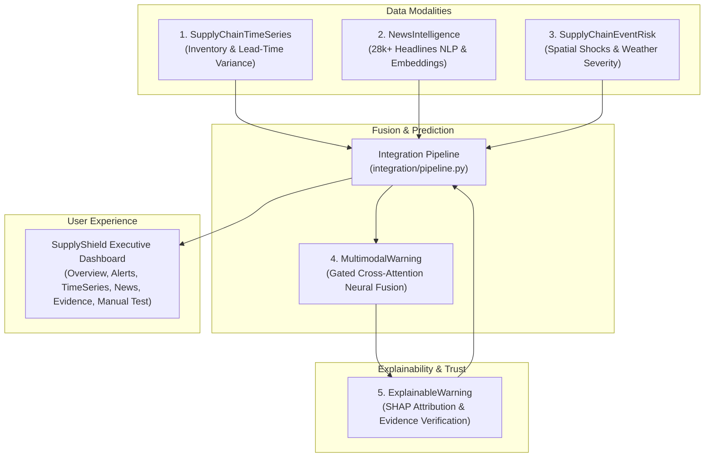

# 🛡️ SupplyShield: Explainable Multimodal Early-Warning System for Supply Chain Disruptions

[](LICENSE)
[](https://www.python.org/)
[](dashboard/index.html)
[](PROJECT_EXPLANATION_GUIDE.md)

SupplyShield is a state-of-the-art, multi-modal, evidence-grounded AI early-warning system designed to predict, explain, and mitigate global supply chain disruptions before physical stock-outs occur.

---

## 🌟 Key Highlights

- **5-Library Unified AI Architecture:** Seamlessly fuses internal enterprise logistics data, global unstructured news intelligence, spatial environmental hazards, deep multimodal classification, and evidence-grounded explainability.
- **Cross-Modal Grounded Explainability:** Employs KernelSHAP, multi-source attribution, and automated contradiction detection to ensure every alert is supported by concrete external facts.
- **Multi-Horizon Disruption Forecasts:** Calibrates risk probabilities into operational horizons: Immediate (<7 days), Short-Term (7–30 days), and Medium-Term (1–3 months).
- **Interactive Executive Dashboard & Sandbox:** Zero-dependency, modern dark glassmorphism web application featuring active alert drill-downs, supplier time-series diagnostics, news intelligence feeds, and a real-time **Manual Prediction Playground**.

---

## 👥 Contributors & Work Division

| Member | Focus Module | GitHub Profile | Core Responsibilities |
|:---|:---|:---|:---|
| **Person 1** | **SupplyChainTimeSeries** | [@rastogikrishna](https://github.com/rastogikrishna) | Lead-time variance, inventory depletion risk, rolling delay lags, demand anomaly filters |
| **Person 2** | **NewsIntelligence** | *(Contributor)* | NLP mining of 28,574 headlines, disruption taxonomies, daily risk index, semantic embeddings |
| **Person 3** | **SupplyChainEventRisk** | [@abhigyanbalodi](https://github.com/abhigyanbalodi) | Spatial hazard distance decay, weather severity modeling, infrastructure stress index |
| **Person 4** | **MultimodalWarning** | *(Contributor)* | Gated cross-modal neural fusion, multi-horizon disruption classification, probability calibration |
| **Person 5** | **ExplainableWarning** | [@andyouranurag](https://github.com/andyouranurag) | Multimodal SHAP attribution, uncertainty estimation, evidence verification & NLG reports |

---

## 🏛️ System Architecture



For complete technical documentation, mathematical models, and feature formulas, please refer to:
📖 [**PROJECT_EXPLANATION_GUIDE.md**](PROJECT_EXPLANATION_GUIDE.md)

---

## 🚀 Getting Started

### 1. View the Interactive Dashboard
The executive web dashboard requires no build step or web server:
1. Navigate to the `dashboard/` directory.
2. Open `index.html` in any web browser (Chrome, Edge, Safari, Firefox).

```bash
# On Windows PowerShell
Start-Process "dashboard/index.html"
```

### 2. Run the End-to-End Integration Pipeline
To re-process features and regenerate predictions:

```bash
# Clone the repository
git clone https://github.com/andyouranurag/SupplyShield.git
cd SupplyShield

# Install dependencies
pip install -r requirements.txt

# Run the complete pipeline
python integration/pipeline.py
```

All standardized outputs and reports will be exported to `integration/outputs/`.

---

## 📂 Repository Directory Structure

```text
SupplyShield/
├── SupplyChainTimeSeries/      # Person 1: Temporal & inventory signal modeling
├── NewsIntelligence/           # Person 2: NLP news mining & daily disruption risk
├── SupplyChainEventRisk/       # Person 3: Spatial hazard & weather exposure
├── MultimodalWarning/          # Person 4: Deep multimodal neural fusion architecture
├── ExplainableWarning/         # Person 5: Evidence-grounded explainability & SHAP
├── integration/                # End-to-end integration orchestrator & pipelines
│   ├── pipeline.py             # Main integration script
│   └── outputs/                # Calibrated predictions, SHAP weights, evidence records
├── dashboard/                  # Executive Dashboard Web Application
│   ├── index.html              # Modern dark-mode UI with Manual Playground
│   ├── style.css               # Glassmorphism design system
│   └── app.js                  # Reactive charting, live gauge & prediction engine
├── configs/                    # Pipeline configuration files
├── PROJECT_EXPLANATION_GUIDE.md# Comprehensive technical & viva presentation guide
└── README.md                   # Repository overview and quickstart
```

---

## 📄 License
This project is licensed under the MIT License.
